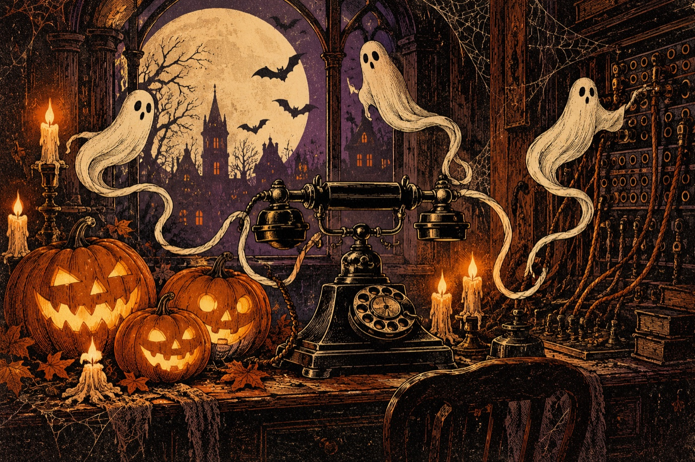
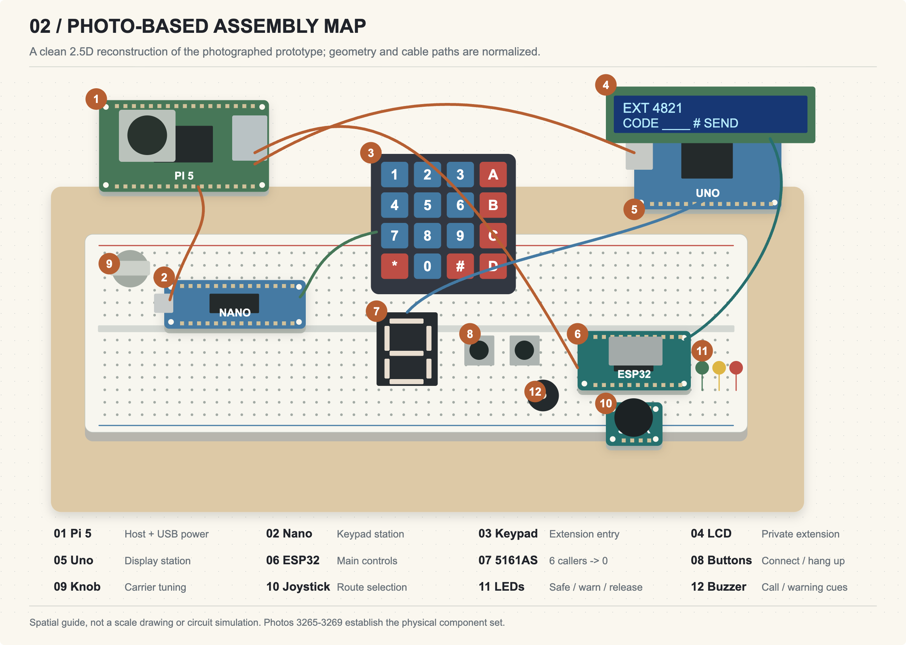

# Dead Channel · Please Hold

**Six callers. One Halloween night shift. Do not wake the operator.**

An interactive telephone-exchange horror game, built alongside a physical console with a Raspberry Pi 5, ESP32, Arduino Uno and Arduino Nano.

**[Play in your browser →](https://adr1el-m.github.io/channel/)** · **[Build guide](documentation/BUILD-GUIDE.md)** · **[Wiring atlas](documentation/diagrams/)** · **[Illustrated dossier](documentation/Dead-Channel-Build-Dossier.pdf)**



## Play the public demo

No electronics, account or installation required. Use a desktop browser or touch device. Sound is optional; enable it with the sound button. Progress is saved in your current browser.

1. **Tune:** drag the tuning slider below the game until a caller comes through. Keep the signal steady to reveal the extension.
2. **Dial:** enter the four-digit extension using the on-screen keypad or your keyboard, then `#`. `*` clears an entry.
3. **Route:** read the caller's message and choose their destination with arrow keys, WASD or touch arrows. Dialing correctly does not solve the destination.
4. **Connect:** hold Space, the on-screen HOLD TO CONNECT button, or touch ACT. Release before the operator's eye turns red. Partial progress is retained.

Green means safe; yellow warns; red means the operator is watching. Wrong codes, wrong routes and holding while watched raise attention. Silence lowers it. HANG UP (or H) lowers attention but clears the current connection and changes its extension. Connect all six callers to finish the shift. P pauses.

Six earlier arcade cartridges are available under **Recovered arcade cartridges**. Their controls and objectives appear when selected.

## Hardware version

The same game can be operated on a real desk. The browser owns the game state. A local Python server on the Pi bridges inputs and outputs through three independent USB serial connections:

| Station | Inputs | Outputs |
|---|---|---|
| ESP32 | Joystick, tuning potentiometer, connect button | Green/yellow/red LEDs and short buzzer cues |
| Uno | Serial commands | 16×2 I2C LCD and single 5161AS caller counter |
| Nano | 4×4 extension keypad and hang-up button | Key events over USB |



The assembly illustration normalizes the photographed build. It is not a Tinkercad simulation or a verified reconstruction of hidden breadboard rows. Use the [pin-level CSV](documentation/wiring-netlist.csv) and [station diagrams](documentation/diagrams/) as the logical connection reference, then verify actual wiring.

The public demo replaces desk controls with browser controls. It does not connect to the author's Pi or drive remote hardware. The full hardware version runs separately on a trusted local network; see [Pi setup](PI-SETUP.md) and the [portable build guide](documentation/BUILD-GUIDE.md).

## Run locally

Requires Node.js 22+ for the build and tests; the game has no npm dependencies.

```sh
npm test
npm run build
python3 -m http.server 8080 --directory dist
```

Open `http://localhost:8080/` for the public browser demo. The static build explicitly disables USB bridge requests and works under a subdirectory such as GitHub Pages' `/channel/`.

For real hardware, flash the matching sketches and run the Python bridge with your own serial-device paths:

```sh
python3 server.py --serial /dev/serial/by-id/YOUR_ESP32 --lcd-serial /dev/serial/by-id/YOUR_UNO --keypad-serial /dev/serial/by-id/YOUR_NANO
```

Then open `http://PI_LAN_ADDRESS:8765/` on the same network. Python 3 standard library only; the bridge uses POSIX serial APIs. The public Pages site never hosts this serial server.

## Documentation and verification

- [Illustrated 15-page build dossier](documentation/Dead-Channel-Build-Dossier.pdf)
- [Architecture, assembly, three wiring drawings and game timing](documentation/diagrams/)
- [Component netlist: CSV](documentation/wiring-netlist.csv) / [JSON](documentation/wiring-netlist.json)
- [Build photographs](documentation/photos/)
- [Evidence and unresolved hardware checks](documentation/EVIDENCE.md)
- [Project article](documentation/FORUM-POST.md)

The 30-test Node suite checks game engines, display policy and a complete simulated console shift. Browser QA additionally exercises the public demo through all six callers, pause/resume, saved ending, responsive layouts and absence of hardware API requests. These software checks do not establish electrical measurements or a complete physical win. A gameplay recording was reported by the builder; its link will be added when available.

## Automatic deployment

Pushing `main` runs the tests, builds only `web/` into `dist/`, and publishes the static artifact through GitHub Actions to GitHub Pages. Python, firmware, source photographs and host configuration are not part of the deployed game artifact. The workflow is in [.github/workflows/pages.yml](.github/workflows/pages.yml).

## Project layout

```text
web/           Game, UI, procedural audio and artwork
firmware/      ESP32, Uno display and Nano keypad sketches
server.py      Local HTTP / USB bridge
pi_gateway.py  Optional development gateway to a local Pi
scripts/       Public build and Pi deployment helpers
tests/        Dependency-free game/display tests
documentation/ Wiring atlas, photographs and illustrated guide
```

## Credits

Physical build and project by **Adriel Magalona**. Software, documentation and Canvas artwork were developed with AI coding assistance. The Halloween illustrations were AI-generated; prompts are included in [web/art/](web/art/). Assembly photographs show the real prototype. Browser sound is procedural. Arduino/ESP32 toolchains and Bill Perry's hd44780 library retain their own licenses and attribution.

This repository does not currently grant a project-wide open-source license. Source is published for inspection; retain third-party notices and obtain appropriate permission before redistribution beyond applicable rights.
