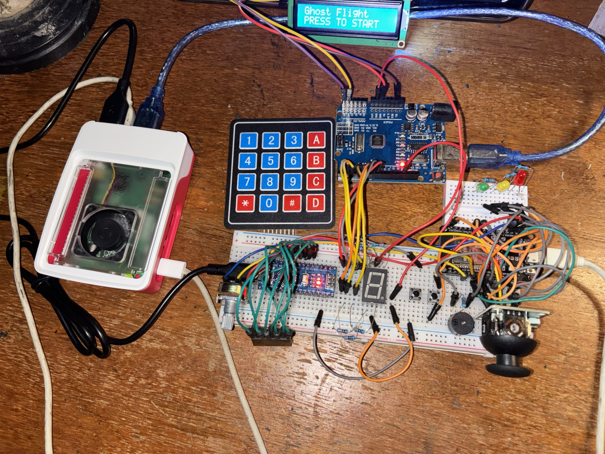
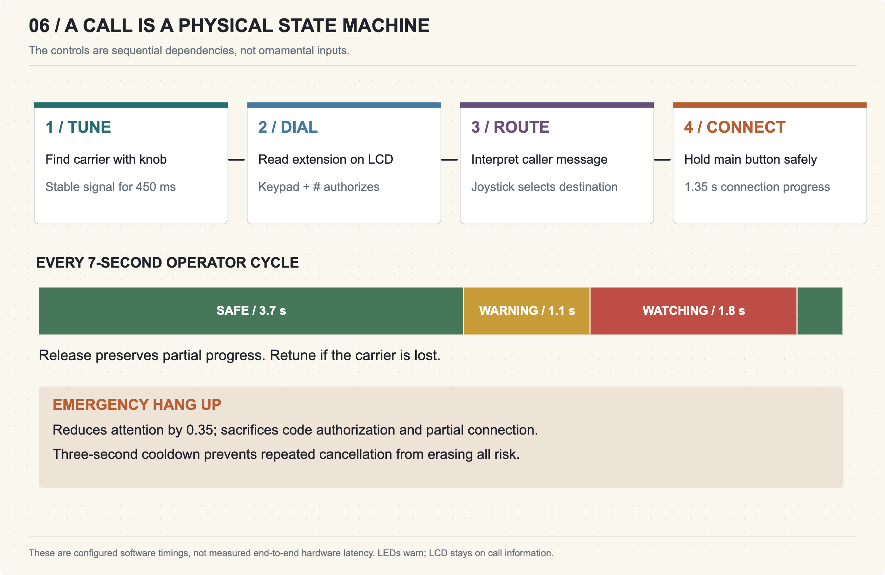
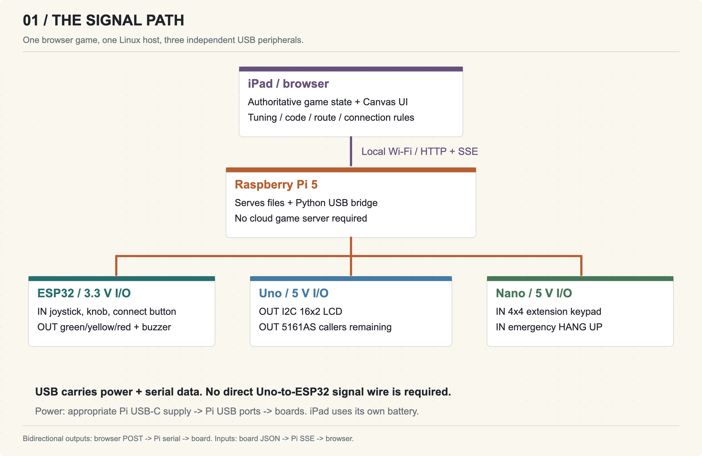
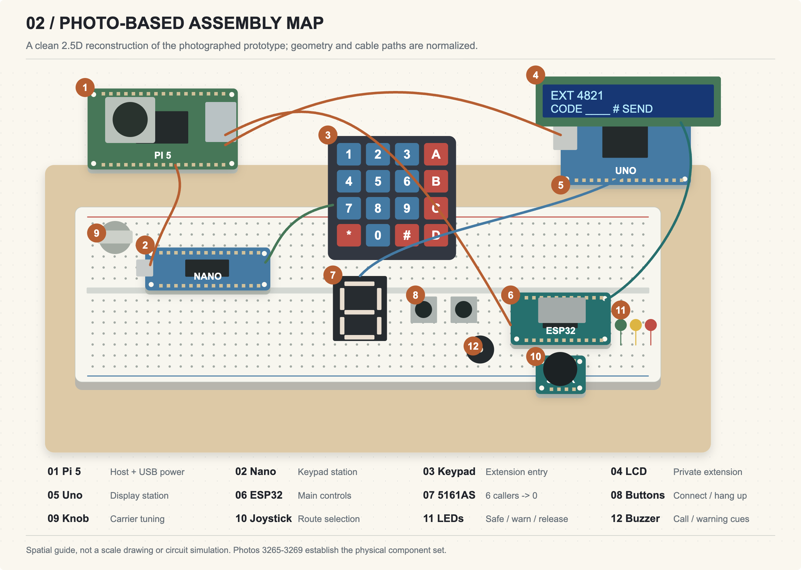
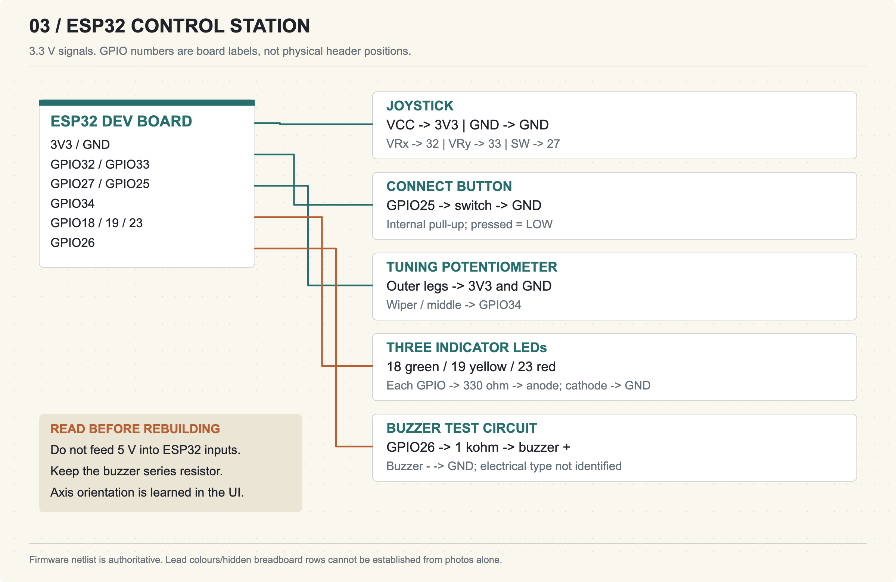
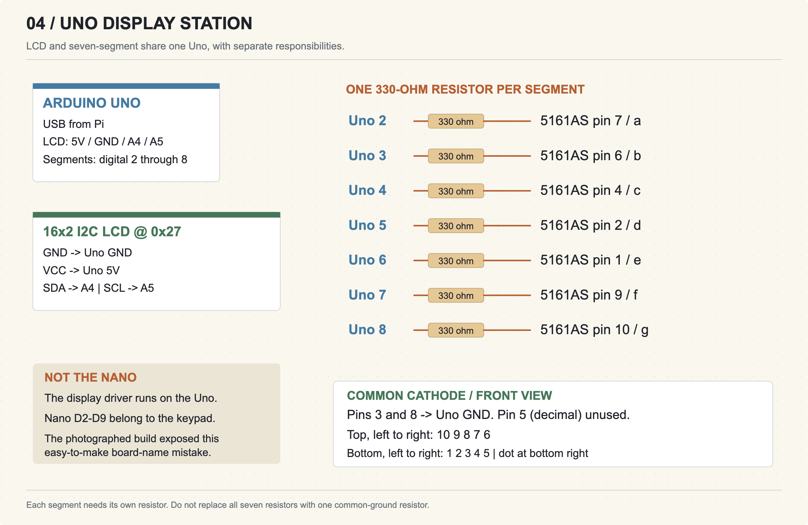
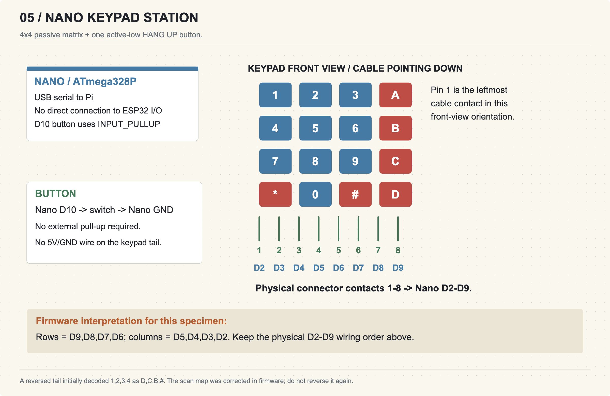

# Dead Channel: Please Hold — a haunted telephone exchange you can actually operate

*An iPad, a Raspberry Pi and three USB-connected microcontrollers turn a breadboard into a Halloween night shift.*

Six people are calling from rooms that were demolished in 1906. Your job is to get them home. Find a carrier with a real tuning knob, read the extension on a small LCD, dial it on a membrane keypad, interpret the caller's message and choose a destination with a joystick. Then hold the connection button — and let go before the operator catches you.

That is **Please Hold**, the flagship game inside my **Dead Channel** arcade. The horror comes from dividing your attention between a screen and the equipment on the desk. The keypad is how you obtain authorization; the knob is how you keep the line alive; the separate hang-up button is how you sacrifice your work to escape a dangerous call.

*The photographed build, with the Pi, three USB boards and the control stations. The LCD is displaying the Ghost Flight cartridge menu in this photograph; the hardware is shared with Please Hold.*

> **Gameplay video:** the recording will be added here before publication. This draft does not yet include a video link.

## A small game with a physical reason to exist

I wanted each added part to change what the player does. That gave the console four linked actions:

1. **Tune.** Rotate the potentiometer until the caller's carrier is clear. Hold it steady for 450 ms to recover the message and extension.
2. **Dial.** Enter the four-digit extension on the Nano's keypad. `#` submits and `*` clears. A correct code authorizes the line; it does not solve the caller's request.
3. **Route.** Interpret the message and use the joystick to select one of six destinations: platform, kitchen, ward, attic, phone booth or front door.
4. **Connect.** Keep the carrier tuned and hold the main button for 1.35 seconds of safe connection progress. Releasing pauses progress, so there is time to play carefully.

The operator's eye repeats a seven-second cycle. Green means safe; yellow gives a 1.1-second warning; red means the operator is watching for 1.8 seconds. The screen carries the eye and the LEDs carry the warning. **The LCD stays on call information rather than telling the player to release.** That separation makes the desk feel like an instrument you must learn to read.

Wrong codes, wrong routing and holding during red increase attention. Silence lets it fall. The extra button hangs up: attention drops, but the extension changes, authorization and partial connection are lost, and a three-second cooldown prevents repeated cancellation from removing all risk. The seven-segment counter drops from six to zero as callers reach home. Six completed calls end the shift.

The displayed radio scale is fictional game tuning driven by an ADC. This is not an RF receiver, and the callers are written messages with procedural sound rather than recordings of real people.

## The complete signal path

The **browser runs the game state** and draws the Halloween scene. The Raspberry Pi 5 serves the files and bridges browser requests to three USB serial devices. The ESP32 handles the analog controls, main button, LEDs and buzzer. The Uno handles the LCD and seven-segment display. The Nano scans the keypad and the hang-up button.

The browser receives input through server-sent events; output requests travel back through the Pi to the appropriate board. This is a local-network system. The iPad and Pi need the same reachable network, but the running game has no cloud service dependency. Once configured, the Pi can host the game without the Mac.

Three microcontrollers are a modular prototype choice, not a requirement for this amount of I/O. Separate USB stations let me test the keypad and display independently and retain the hardware already assembled. They also introduce real costs: more cables, USB identification and reconnect logic. A later custom controller could consolidate them.

## Parts and power

The build uses a Pi 5; ESP32 development board; Uno-compatible board; classic Nano-compatible board; iPad/browser; analog joystick; potentiometer; 4×4 keypad; two external buttons; green, yellow and red LEDs; two-pin buzzer; 16×2 I2C LCD; 5161AS common-cathode display; breadboards, jumpers and three USB data cables.

There are **ten nominal 330-ohm resistors**: one for each of the three LEDs and one for each of the seven display segments. The prototype buzzer branch has a nominal **1-kilohm series resistor**. The five-band codes used were orange–orange–black–black–brown for 330 ohms and brown–black–black–brown–brown for 1 kilohm. These are specified nominal values, not meter measurements.

An appropriate Pi USB-C supply powers the host; its USB ports carry power and data to the three boards. The LCD is on the Uno's 5 V domain. The joystick and potentiometer are on the ESP32's 3.3 V domain. No direct 5 V logic connection runs from the Uno or Nano into the ESP32. The final arrangement does not require the previously considered 9 V battery.

The buzzer's exact part number and electrical type remain unidentified. The diagram records the current-limited prototype branch; it is not a universal buzzer driver recommendation. Before copying that branch with a different buzzer, identify its voltage/current requirements and use an appropriate driver if needed. Supply current and end-to-end latency have not been measured.

## A wiring atlas rather than a cable guessing game

*An editable, normalized 2.5D assembly drawing based on the supplied photographs. Component placement and cable paths are simplified. This is an illustration, not a Tinkercad simulation or proof of hidden breadboard connections.*

The three station drawings below are the logical wiring reference. The accompanying CSV and JSON netlists record the same connections. GPIO names are board labels, not physical header positions. Disconnect power while changing wiring, and check split breadboard rails and common ground before turning it back on.

### 1. Build the ESP32 control station

Power the joystick and potentiometer from 3.3 V. Connect VRx to GPIO32, VRy to GPIO33, joystick switch to GPIO27 and potentiometer wiper to GPIO34. The main connect button goes between GPIO25 and GND. Both buttons use internal pull-ups.

Green, yellow and red LED anodes connect through separate 330-ohm resistors to GPIO18, GPIO19 and GPIO23 respectively; cathodes return to GND. The documented prototype buzzer branch is GPIO26 → 1 kilohm → buzzer positive, with its other lead to GND.

Run the joystick direction-learning controls in the browser. Physical module orientation can swap the apparent axes; correcting the mapping is preferable to assuming that pushing the stick toward a printed label must mean “up.” Calibration is stored per browser origin, so the iPad needs its own setup.

### 2. Build the Uno display station

Connect LCD GND to Uno GND, VCC to 5 V, SDA to A4 and SCL to A5. This particular backpack uses address `0x27`; another module may differ. The firmware uses Bill Perry's hd44780 library, version 1.3.2 in this build.

For the 5161AS, view the digit from the front with its decimal point at bottom right. Connect common pins 3 and 8 to GND. Uno pins 2–8 drive segments a–g through **seven individual resistors**, with display pin order `7, 6, 4, 2, 1, 9, 10`. Decimal-point pin 5 is unused. These display wires belong to the **Uno**, not the Nano.

### 3. Build the Nano keypad station

With the keypad facing forward and its cable pointing down, its eight connector contacts run left to right into Nano D2 through D9. For this specimen the corrected firmware row order is `9,8,7,6` and column order is `5,4,3,2`. Preserve the physical contact order shown; do not reverse both wiring and firmware.

The separate hang-up button connects D10 to Nano GND, using the internal pull-up. It needs no external pull-up resistor. Test every key after assembly, including `*`, `#` and the separate button.

## Bring-up, one station at a time

Flash the three matching sketches in the source attachment. Install the hd44780 library for the Uno and the appropriate board core for each board. Connect each station to the Pi with a USB data cable and identify the serial devices; use persistent by-id paths when several adapters are present. The bridge opens each board separately at 115200 baud.

Run `python3 server.py` on the Pi, then open `http://PI_LAN_ADDRESS:8765/` from the iPad. The Python server uses the standard library. This is intended for a trusted local network rather than public port forwarding. Enable browser audio with a gesture if desired; visual indicators carry the necessary game information.

Before starting a physical shift, check live joystick and knob values, the main button, each LED individually, readable LCD text, display digits 0–9, all keypad keys and hang-up. Required controller/display health is reported to the browser, and losing a required device pauses a hardware run. Rehearsal mode provides the same rule loop with on-screen controls for development.

## The faults that taught me the most

**“USB connected” did not mean “LCD working.”** A loose connection could leave the backlight on or show blocks. Later the I2C address acknowledged but initialization still failed. The library's automatic instance search was advancing across retries. Constructing the display explicitly at the known `0x27` address retained backpack mapping discovery while avoiding that repeated-search problem. Separate I2C and initialization telemetry made those two failures distinguishable.

**The keypad arrived backwards in software.** An initial press sequence of 1, 2, 3, 4 decoded as D, C, B, #. Correcting the row/column mapping matched the actual connector orientation without rewiring the assembled station.

**The digit was connected to the wrong Arduino.** It shared the desk with the Nano, but its driver was on the Uno. Moving the segment wires to the correct board and completing the common ground made the digit test work. That is why the atlas labels the board as well as every pin.

**One surviving USB device was misleading.** A Pi USB host-controller fault disconnected the ESP32 and Uno while the Nano remained visible. A clean reboot restored all three. The kernel reported a host-controller failure; the underlying cause was not established. I would not label it a proven power fault without measurements.

## Validation and the next revision

The current dependency-free Node suite passes **30 engine/display tests**. Development checks also included a complete six-call browser rehearsal and a separate integration run using simulated inputs with real Pi-connected outputs, including an acknowledged LCD extension and a counter transition from six to five. Those are useful checks, but they are distinct from a complete physical playthrough.

The physical build and component confirmations are documented in the photographs and build notes. A gameplay recording has been made and will be linked after review. I have not yet used that recording to substantiate a complete hardware win or a measured response time.

My next hardware revision would secure the LCD connectors, identify and properly characterize the buzzer, and measure supply current and response latency. An enclosure with labelled controls would make it easier to transport without disturbing the breadboard. The strongest improvement is reliability: the horror should come from the operator, not an intermittent SDA wire.

## Try it and inspect the source

[Play the browser demo](https://adr1el-m.github.io/channel/) with keyboard/touch controls, an on-screen tuning slider and extension keypad. The hosted demo runs entirely in your browser; it does not access the physical console. [The source, firmware, wiring atlas and build documentation are on GitHub](https://github.com/adr1el-m/channel).

## Files, artwork and acknowledgements

The companion build dossier contains the station diagrams, component purposes, electrical notes, firmware/protocol guide and validation record. The editable SVGs and CSV/JSON netlist are included alongside the source snapshot. The six earlier arcade cartridges remain available; this article concentrates on Please Hold because it uses the full console as one coherent game.

The Halloween illustration was generated with AI assistance; its prompt/provenance is included in `web/art/HALLOWEEN-PROMPT.md`. Canvas overlays, procedural Web Audio, game logic and documentation were developed with AI coding assistance and iterated against the physical build. The assembly photographs are of the real prototype. No Tinkercad simulation or commissioned hand-drawn artwork is being claimed. Thanks to the authors of the Arduino/ESP32 toolchains and Bill Perry's hd44780 library.

*Build by Adriel Magalona. Documentation edition: 30 October 2026. Gameplay media to be added before publication.*
